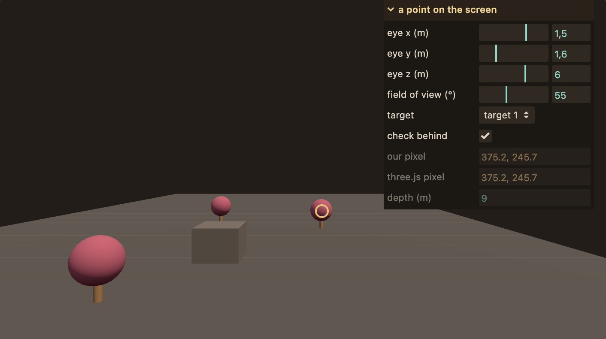

import LiveCode from '../../../../components/LiveCode.astro';
import Margen from '../../../../components/Margen.astro';
import Diario from '../../../../components/Diario.astro';

Un motor de 3D hace, sesenta veces por segundo, la misma pregunta para cada punto de cada cosa que dibuja: **¿en qué lugar de la pantalla cae?** Todo lo demás (la luz, las sombras, las texturas) viene después de contestarla. En este capítulo la contestamos nosotros: primero con lápiz y después con código, y al final vamos a comprobar que nuestra cuenta coincide con la de three.js, la biblioteca que dibuja, hasta la décima de píxel.

Al terminar vas a tener la primera pieza del mundo: una ventana con un piso, una torreta en el medio y tres blancos sobre postes, y un anillo que marca dónde dicen **tus** números que cae cada blanco.

## Antes de dibujar, decir dónde

Para que una computadora dibuje algo, primero hay que decirle dónde está, y eso se dice con números.

Sobre una recta alcanza con uno. Elegimos un punto, el **origen**, una **unidad** (el metro) y un **sentido**, el de los positivos. Cualquier punto de la recta es entonces un número: cuántas unidades hay desde el origen, y hacia qué lado. En un plano hacen falta dos rectas perpendiculares que se cruzan en el origen, y cada punto es un par de números. En el espacio, tres: cada punto es una terna $(x, y, z)$.

Nuestros tres ejes, los de todo el libro: $+X$ hacia la derecha, $+Y$ hacia arriba, y $+Z$ hacia vos, saliendo de la pantalla. Todo en metros.

¿Por qué $+Z$ hacia vos, y no hacia adentro? Es una elección, y hay que hacerla una vez. Con la mano derecha: el pulgar hacia $+X$, el índice hacia $+Y$, y el mayor, doblado hacia vos, apunta a $+Z$. Por eso este sistema se llama **de mano derecha**, y es el de three.js, Godot y la mayoría de los libros de matemática. Por ahora es una convención; en el capítulo 3 vamos a ver que la mano se puede decidir con una cuenta.

<Margen kind="motores" title="Otras manos, otro arriba">
  Unity usa la mano izquierda ($+Z$ hacia adentro de la pantalla) y Unreal, la izquierda con $+Z$ hacia arriba, y además mide en
  centímetros. Los mismos tres números, en otro motor, son **otro punto**: el $(3, 2, 1)$ de three.js está, en Unity, del otro
  lado del plano $z = 0$. Pasar de uno al otro es cambiar el signo de una coordenada (y a veces intercambiar dos): cada cambio de
  signo o intercambio da vuelta la mano, así que dos de ellos la dejan como estaba.
</Margen>

### Cuánto hay de un punto a otro

La primera cuenta que hace un juego con coordenadas es una distancia: ¿a cuántos metros está el blanco? Con dos puntos, $P = (p_x, p_y, p_z)$ y $Q = (q_x, q_y, q_z)$, las diferencias $\Delta x = q_x - p_x$, $\Delta y = q_y - p_y$ y $\Delta z = q_z - p_z$ dicen cuánto hay que andar a lo largo de cada eje.

Mirando solo el piso, $\Delta x$ y $\Delta z$ son los catetos de un triángulo rectángulo, porque los ejes son perpendiculares. Su hipotenusa es la distancia sobre el piso, $\sqrt{\Delta x^2 + \Delta z^2}$. Esa distancia y la altura $\Delta y$ son a su vez los catetos de otro triángulo rectángulo, parado. Pitágoras dos veces:

$$
d(P, Q) = \sqrt{\left(\sqrt{\Delta x^2 + \Delta z^2}\right)^2 + \Delta y^2} = \sqrt{\Delta x^2 + \Delta y^2 + \Delta z^2}.
$$

Funciona porque los tres ejes son perpendiculares entre sí y miden en la misma unidad. Si no lo fueran, Pitágoras no valdría.

<LiveCode lesson="parte-1/coordinates" figure />

En la figura, $P$ y $Q$ se arrastran por el piso, y la altura de $P$ cambia en el panel. Tocá _worked example_: $P = (3;\ 2;\ 1)$ y $Q = (-1;\ 0{,}5;\ -2)$. Las diferencias son $(-4;\ -1{,}5;\ -3)$, la distancia sobre el piso es $\sqrt{16 + 9} = 5$, y la de verdad, $\sqrt{25 + 2{,}25} = \sqrt{27{,}25} \approx 5{,}2202$ metros. Al lado, three.js dice lo mismo. Tildá _left-handed_: el dibujo se espeja y los números no cambian. Es el mismo cálculo, en otro dibujo.

## Mirar por un agujero

Ahora la pregunta del capítulo: ¿dónde se ve un punto?

La cámara más vieja que existe es un cuarto oscuro con un agujero chico en una pared. La luz de cada punto de afuera entra por el agujero en línea recta y pega en la pared de enfrente: ahí se forma la imagen, dada vuelta. Ordenemos eso. Ponemos el ojo, el agujero, en el origen, mirando hacia $-Z$, y en lugar de la pared de atrás, una pantalla un metro **delante** del ojo, donde la imagen sale derecha. La pregunta es: la recta que va del ojo al punto $P$, ¿dónde cruza esa pantalla?

Si $P$ está a una profundidad $d$ delante del ojo (es decir, $d = -z$) y a una altura $y$, hay dos triángulos rectángulos con el mismo ángulo en el ojo: uno grande, con catetos $d$ y $y$, y uno chico, con catetos $1$ y la altura $y'$ en la pantalla. Son semejantes, así que sus lados son proporcionales:

$$
\frac{y'}{1} = \frac{y}{d}, \qquad\text{y lo mismo de costado,}\qquad x' = \frac{x}{d}.
$$

**Proyectar es dividir por la profundidad.** Esa división es toda la perspectiva.

Hay otra manera de verlo, que no necesita dibujo. Los puntos de la recta que va del ojo a $P$ son los $s\,P$, con $s$ entre $0$ (el ojo) y $1$ (el punto). La pantalla está donde la profundidad vale 1, y la profundidad de $s\,P$ es $s\,d$: la recta la cruza en $s = 1/d$, en el punto $(x/d,\ y/d)$. El mismo resultado, y ahora sin triángulos.

De esa división sale todo lo que reconocemos como perspectiva:

- **Lo lejano se ve chico.** Algo de alto $s$ a la profundidad $d$ mide $s/d$ en la pantalla: el doble de lejos, la mitad de alto.
- **Las paralelas se juntan.** Una recta que sale de un punto $P_0$ en la dirección $w$ tiene los puntos $P_0 + t\,w$. Su imagen es $\bigl(x_0 + t\,w_x\bigr) / \bigl(d_0 - t\,w_z\bigr)$ de costado, y lo mismo para la altura. Cuando $t$ crece sin fin, el cociente tiende a $w_x / (-w_z)$: **no depende de dónde empieza la recta**. Todas las rectas con la misma dirección terminan en el mismo punto de la pantalla, el **punto de fuga**. Las vías del tren se juntan en el horizonte porque son paralelas.

<LiveCode lesson="parte-1/projection" figure />

En la figura, a la izquierda el mundo visto de costado, con el ojo, la pantalla y la recta de cada punto; a la derecha, la foto que saca three.js con sus propias cuentas, y nuestros anillos encima. Arrastrá el punto y mirá cómo cambian los dos lados juntos. Girá las vías con el panel: su punto de fuga se mueve, y las dos vías siempre llegan juntas a él.

## Lo que no se ve

Hay un caso que la fórmula no contempla. Si el punto está **detrás** del ojo, su profundidad $d$ es negativa, y la división igual da un número: el punto cae en la pantalla dado vuelta, arriba por abajo y la izquierda por la derecha. Y si está justo a la altura del ojo, $d = 0$, la división no se puede hacer.

Una cámara de verdad no ve lo que tiene detrás, así que nuestra cuenta tiene que preguntarlo antes de dividir: **si $d \le 0$, el punto no se ve.** Es una de esas líneas que parecen obvias, y cuya falta da algunos de los errores más raros de un motor: cosas que aparecen en el cielo, espejadas, cuando la cámara pasa al lado de ellas. En el proyecto, al final del capítulo, vas a poder sacar esa pregunta y verlo pasar.

## Cuánto se ve

La pantalla a un metro del ojo es infinita; la ventana del navegador, no. Lo que se ve depende del **campo de visión** (_field of view_), el ángulo $\varphi$ que abarca la cámara de arriba abajo. La pantalla a un metro mide entonces, de su centro a su borde de arriba,

$$
h = \tan\frac{\varphi}{2},
$$

y de su centro al borde de costado, $a\,h$, con $a$ la proporción de la ventana, su ancho dividido por su alto. Dividiendo por esos medios tamaños, cada punto de la ventana queda entre $-1$ y $1$:

$$
u = \frac{x'}{a\,h}, \qquad v = \frac{y'}{h}.
$$

El último paso es pasar a píxeles, que se cuentan desde la esquina de arriba a la izquierda, con $y$ hacia abajo. En una ventana de $W \times H$ píxeles:

$$
p_x = \frac{u + 1}{2}\,W, \qquad p_y = \frac{1 - v}{2}\,H.
$$

El $1 - v$ da vuelta el eje: en el mundo, $+Y$ es hacia arriba; en la pantalla, los píxeles crecen hacia abajo.

<Margen kind="sabe" title="¿Y la matriz de proyección?">
  Si ya trabajaste con gráficos, esperabas una matriz de $4 \times 4$ con una coordenada $w$. Es esta misma cuenta, escrita de
  manera que la placa de video la haga para millones de puntos de una vez: la división por $w$ es nuestra división por la
  profundidad. Llega en el capítulo 4, cuando las matrices tengan sentido; acá la idea queda a la vista, sin la maquinaria.
</Margen>

Una trampa con el campo de visión: el horizontal **no** es $a\,\varphi$. Los ángulos no crecen como las distancias en la pantalla; las tangentes sí. El medio ancho es $a\,h = a \tan(\varphi/2)$, así que el campo horizontal $\theta$ cumple $\tan(\theta/2) = a \tan(\varphi/2)$.

### Una cuenta entera

El ojo en $(0;\ 1;\ 2)$ mirando hacia $-Z$, con $\varphi = 55^\circ$, en una ventana de $800 \times 450$, y el punto $P = (1;\ 1{,}5;\ -3)$:

- visto desde el ojo, $P$ está a $1$ m a la derecha, $0{,}5$ m arriba y $d = 2 - (-3) = 5$ m adelante;
- en la pantalla a un metro: $(x', y') = (1/5;\ 0{,}5/5) = (0{,}2;\ 0{,}1)$;
- $h = \tan 27{,}5^\circ \approx 0{,}5206$ y $a = 800/450$, así que $a\,h \approx 0{,}9255$: $u \approx 0{,}2161$ y $v \approx 0{,}1921$;
- en píxeles: $p_x \approx 486{,}4$ y $p_y \approx 181{,}8$. Un poco a la derecha del centro, y arriba;
- el campo horizontal: $\tan(\theta/2) = 1{,}778 \cdot 0{,}5206 \approx 0{,}9255$, así que $\theta \approx 85{,}6^\circ$, y no $97{,}8^\circ$.

## Una ventana al mundo

Con la cuenta entendida, el proyecto empieza. Para dibujar hacen falta cuatro cosas: algo que le hable a la placa de video (un _renderer_), una escena con lo que hay, una cámara desde donde se ve, y un bucle que dibuje todo de nuevo en cada cuadro. three.js trae las cuatro.

Y la primera decisión del proyecto, que sostiene todo el libro: **el mundo son datos, y el dibujo los lee.** Dónde está la torreta y dónde cada blanco son números en un objeto común; three.js no guarda el mundo, lo dibuja. Parece un detalle, y es lo que en el acto II nos va a permitir repetir una partida entera, compararla número por número y correr el mundo sin pantalla. Una escena de three.js no se puede comparar ni mandar por la red; un objeto con números, sí.

<LiveCode project="material/01-un-punto" follow />

El proyecto tiene cinco archivos, y cada uno hace una sola cosa:

- **`view/view.ts`, la ventana:** el renderer, la escena, la cámara (puesta en `eye`, con su campo de visión en grados, mirando hacia $-Z$), una luz, y `onFrame`, que en cada cuadro llama a quien quiera actualizar algo y después dibuja. La ventana conserva sus proporciones cuando cambia de tamaño.
- **`view/screen.ts`, nuestra cuenta:** `toScreen` hace los cuatro pasos de arriba, un renglón cada uno. Pregunta si el punto está delante antes de dividir, salvo que se le pida no hacerlo (`check` en falso). `Math.tan` pide radianes: la mitad del campo de visión, en radianes, es `fov * Math.PI / 360`.
- **`world.ts`, el mundo como datos:** el tamaño del piso, dónde está la torreta y dónde cada blanco, con su nombre. No importa nada de three.js.
- **`layouts.ts`, los niveles:** el primero tiene la torreta en el origen y tres blancos a medio metro del piso.
- **`main.ts`, el arranque:** en orden, la ventana, el mundo y el dibujo hecho a partir del mundo. En cada cuadro, el panel pone la cámara, y se compara `toScreen` con la cuenta de three.js (`project`, que usa sus matrices).

La carpeta `view/` junta todo lo que dibuja. Lo que queda afuera, el mundo y los niveles, no sabe que existe una pantalla.

Probá:

1. **Elegí cada blanco en el panel:** _our pixel_ (nuestro píxel) y _three.js pixel_ coinciden en los tres, a la décima. El primero está a $9$ m de profundidad, el segundo a $4$ y el tercero a $10$.
2. **Mové la cámara** con los controles _eye x_, _eye y_ y _eye z_, o cambiá el campo de visión: el anillo sigue a la bola, siempre.
3. **Pasá la cámara de largo:** llevá _eye z_ a $-5$, más allá del primer blanco. three.js dice _behind the camera_, y nuestro anillo desaparece. Ahora destildá _check behind_ (preguntar si está detrás): el anillo vuelve a aparecer, en un lugar donde no hay nada. Es el blanco que está detrás de vos, proyectado dado vuelta.

Una última cosa que hace `main.ts`: cuando la página se cierra, devuelve todo lo que pidió, en el orden inverso al del arranque. Cada forma y cada material que se le pide a la placa de video ocupa su memoria hasta que se la libera (`dispose`), y un programa que rearma su dibujo sin liberar lo anterior la va llenando, hasta que el navegador se niega a darle más.

<Margen kind="manifold" title="La cámara, solo en el dibujo">
  En Manifold, la cámara vive en la presentación (`stage.ts`, `camera.ts`), nunca en la simulación: el mundo no sabe que alguien
  lo mira. Por eso el mismo mundo corre en un servidor sin pantalla, o en una prueba, igual que en el navegador.
</Margen>

<Diario title="El arma que se metía en las paredes" report="../../../bitacora/etapa-4g/">
  Cuando Manifold sumó la primera persona, el arma del personaje se dibujaba en el mundo, delante de la cámara. Al acercarse a una
  pared, el arma la atravesaba: estaba más adelante que la cámara, y la pared, en el medio. La solución fue usar dos proyecciones.
  El mundo se dibuja con la cámara de siempre, y el arma, encima, con una cámara propia de $50^\circ$ y un plano cercano de un
  centímetro, después de borrar la profundidad. Es la misma cuenta de este capítulo, hecha dos veces con números distintos.
</Diario>

## Lo que tenemos

Una ventana a un mundo descrito como datos, y el píxel de cada punto calculado por nosotros: dividir por la profundidad, escalar por el campo de visión, pasar a píxeles. La cámara todavía no gira (mira siempre hacia $-Z$), y la torreta todavía no ve nada. En el próximo capítulo la torreta tiene que decidir qué tiene delante.

### Retos

**1. El tercer blanco, a mano.** Con la cámara del proyecto en $(1{,}5;\ 1{,}6;\ 6)$, $\varphi = 55^\circ$ y una ventana de $800 \times 450$, calculá el píxel del tercer blanco, en $(-1;\ 0{,}5;\ -4)$. Tiene que dar una profundidad de $10$ y el píxel $(291{,}9;\ 272{,}5)$: a la izquierda y abajo del centro.

**2. Un blanco más.** Agregá un cuarto blanco al nivel, en `layouts.ts`, y comprobá que es el único archivo que tuviste que cambiar. Si el mundo son datos, un nivel nuevo es solo eso: datos.

**3. El tamaño en la pantalla.** Mostrá en el panel cuántos píxeles de alto mide la bola elegida (de $0{,}6$ m). Con la cámara del comienzo, la del primer blanco mide unos $28{,}8$ píxeles: $\frac{0{,}6}{9} \cdot \frac{450}{2 \cdot 0{,}5206}$.

<Margen kind="motores" title="El campo de visión en otros motores">
  En three.js y en Unity, el campo de visión que se elige es el vertical, como acá. Unreal pide el horizontal. Los dos dicen lo
  mismo, conocida la proporción de la ventana: $\tan(\theta/2) = a \tan(\varphi/2)$.
</Margen>
