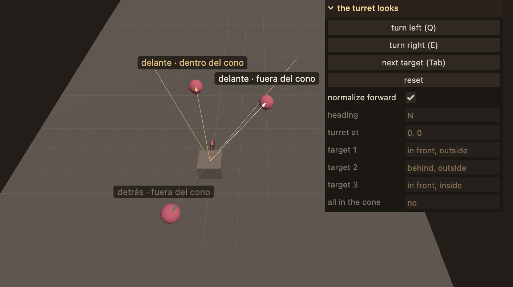

import LiveCode from '../../../../components/LiveCode.astro';
import Margen from '../../../../components/Margen.astro';
import Diario from '../../../../components/Diario.astro';

La torreta está en el medio del piso desde el capítulo anterior, mirando hacia el fondo, y no ve nada. Ahora tiene que contestar, de cada blanco, dos preguntas: **¿lo tengo delante?** y **¿entra en mi cono de tiro?** El cono es lo que la torreta alcanza a apuntar sin girar: $30^\circ$ a cada lado de hacia donde mira.

Al terminar, la torreta va a contestar las dos, y lo vas a ver: una flecha del color de lo que decidió va hacia cada blanco, los bordes del cono están dibujados en el piso, y la torreta gira con el teclado. Para llegar ahí hacen falta dos ideas: el **vector**, que dice cuánto y hacia dónde, y una cuenta entre vectores, el **producto escalar**, que es probablemente la cuenta más usada de todo un motor.

## Una flecha: cuánto y hacia dónde

Un punto dice dónde. Para la torreta importa otra cosa: **cómo se llega** desde ella hasta un blanco. "Dos metros a la derecha y tres hacia el fondo" no dice dónde está nada: es una instrucción, que se puede seguir desde cualquier lugar. Eso es un vector.

Entre dos puntos hay uno: el que lleva del primero al segundo, sus diferencias coordenada a coordenada,

$$
Q - P = (q_x - p_x,\ q_y - p_y,\ q_z - p_z).
$$

Un vector se escribe en negrita y se dibuja como una flecha, pero **la misma flecha en otro lugar es el mismo vector**: lo que importa son sus tres **componentes**, cuánto a lo largo de cada eje. Con ellos se hacen cuentas, componente a componente:

- **Sumar** es hacer un desplazamiento y después el otro: la segunda flecha empieza donde termina la primera. $\mathbf{a} + \mathbf{b} = (a_x + b_x,\ a_y + b_y,\ a_z + b_z)$, y el orden no importa.
- **Multiplicar por un número** $k$ estira la flecha $k$ veces, y si $k$ es negativo, la da vuelta.
- **El largo** es la distancia del capítulo anterior, entre la cola y la punta: $\lvert \mathbf{v} \rvert = \sqrt{v_x^2 + v_y^2 + v_z^2}$. Estirar por $k$ multiplica el largo por $\lvert k \rvert$, porque $\sqrt{k^2} = \lvert k \rvert$.
- **La dirección** sola es el vector dividido por su largo, $\hat{\mathbf{v}} = \mathbf{v} / \lvert \mathbf{v} \rvert$, que mide 1. El vector cero no tiene dirección: mide 0, y no se puede dividir por cero.

<LiveCode lesson="parte-1/vectors" figure />

Las puntas de $\mathbf{a}$ (roja) y $\mathbf{b}$ (azul) se arrastran, y un piloto automático las mueve mientras nadie toca. La dorada es la suma, la diagonal del paralelogramo; la verde, la resta, que va de la punta de $\mathbf{b}$ a la de $\mathbf{a}$; la blanca, $\hat{\mathbf{a}}$, con su punta siempre sobre el círculo de radio 1. Con _worked example_, $\mathbf{a} = (3, 0, -1)$ y $\mathbf{b} = (1, 0, -2)$: la suma es $(4, 0, -3)$, de largo $5$, y los largos de cada uno son $\sqrt{10} \approx 3{,}162$ y $\sqrt{5} \approx 2{,}236$.

<Margen kind="demostracion" title="Restar puntos sí; sumarlos, no">
  El origen es una elección nuestra. Si se lo corre, a todos los puntos se les suma un mismo vector $\mathbf{c}$. La resta $Q - P$
  no cambia, porque $(Q + \mathbf{c}) - (P + \mathbf{c}) = Q - P$: es algo del mundo. La suma $P + Q$ sí cambia, pasa a $P + Q +
  2\mathbf{c}$: con otro origen nombra otro lugar, así que no es un punto del mundo. Una combinación $\alpha P + \beta Q$ cambia
  como un punto (sumando $\mathbf{c}$) exactamente cuando $\alpha + \beta = 1$. Por eso $(1 - s)\,P + s\,Q = P + s\,(Q - P)$ tiene
  sentido: es el punto que está a una fracción $s$ del camino de $P$ a $Q$.
</Margen>

## ¿Delante o detrás?

La torreta está en el origen, mirando hacia $-Z$. La primera idea es simple: un blanco está delante si está más hacia el fondo que ella, si su $z$ es negativa.

Funciona. Hasta que la torreta gira.

<LiveCode lesson="material/front" figure />

En la figura, el ojo está en el centro; la flecha azul, $\mathbf{f}$, es hacia donde mira, y su punta se arrastra para girarlo. La bola roja es el blanco, y $\mathbf{t}$ es el camino hasta él. La mitad del piso que el ojo tiene delante está sombreada, y el blanco se pone dorado cuando está ahí. Al empezar, el blanco está a la derecha y un poco hacia vos: detrás del ojo, que mira al fondo, y las dos reglas están de acuerdo. Tildá _naive rule (z)_ (la regla ingenua) y tocá _turn the eye east_: el ojo mira hacia la derecha, justo al blanco, pero la regla sigue sombreando la mitad del fondo y dice que el blanco está detrás. El panel muestra las dos respuestas.

La regla mira la coordenada equivocada porque la pregunta no es sobre $z$. La pregunta es: **del camino hasta el blanco, ¿cuánto va hacia donde miro?** Imaginá una luz que cae perpendicular sobre la recta de la mirada. El camino $\mathbf{t}$ proyecta una sombra sobre esa recta. Si la sombra cae hacia adelante, el blanco está delante; si cae hacia atrás, detrás. Hace falta una cuenta que mida esa sombra.

### La cuenta

El **producto escalar** de dos vectores es un número: cada componente de uno por la misma del otro, todo sumado.

$$
\mathbf{a} \cdot \mathbf{b} = a_x b_x + a_y b_y + a_z b_z.
$$

Así definido, parece una cuenta cualquiera. Que mida la sombra hay que demostrarlo. Primero, sus reglas, que salen componente a componente de la definición: conmuta ($\mathbf{a} \cdot \mathbf{b} = \mathbf{b} \cdot \mathbf{a}$), distribuye ($\mathbf{a} \cdot (\mathbf{b} + \mathbf{c}) = \mathbf{a} \cdot \mathbf{b} + \mathbf{a} \cdot \mathbf{c}$), los números salen afuera ($(k\,\mathbf{a}) \cdot \mathbf{b} = k\,(\mathbf{a} \cdot \mathbf{b})$), y la más importante: **un vector consigo mismo da su largo al cuadrado**, $\mathbf{a} \cdot \mathbf{a} = a_x^2 + a_y^2 + a_z^2 = \lvert \mathbf{a} \rvert^2$. Por esa última, el producto escalar sabe de largos. Y con largos, por Pitágoras, se llega a los ángulos.

### Perpendiculares, por Pitágoras

Dos vectores $\mathbf{a}$ y $\mathbf{b}$ dibujados desde un mismo punto son dos lados de un triángulo, y el tercer lado es $\mathbf{a} - \mathbf{b}$. Su largo al cuadrado, con las reglas de arriba:

$$
\lvert \mathbf{a} - \mathbf{b} \rvert^2 = (\mathbf{a} - \mathbf{b}) \cdot (\mathbf{a} - \mathbf{b}) = \lvert \mathbf{a} \rvert^2 + \lvert \mathbf{b} \rvert^2 - 2\,\mathbf{a} \cdot \mathbf{b}.
$$

Pitágoras y su recíproco dicen que el ángulo entre $\mathbf{a}$ y $\mathbf{b}$ es recto **si y solo si** $\lvert \mathbf{a} - \mathbf{b} \rvert^2 = \lvert \mathbf{a} \rvert^2 + \lvert \mathbf{b} \rvert^2$. Comparando, eso pasa exactamente cuando el término que sobra es cero:

$$
\mathbf{a} \perp \mathbf{b} \iff \mathbf{a} \cdot \mathbf{b} = 0.
$$

### La sombra

Ahora sí. Sea $\hat{\mathbf{u}}$ una dirección (un vector de largo 1). Cualquier vector $\mathbf{a}$ se puede partir en dos pedazos, uno a lo largo de $\hat{\mathbf{u}}$ y otro de través:

$$
\mathbf{a} = (\mathbf{a} \cdot \hat{\mathbf{u}})\,\hat{\mathbf{u}} + \bigl(\mathbf{a} - (\mathbf{a} \cdot \hat{\mathbf{u}})\,\hat{\mathbf{u}}\bigr).
$$

Que suman $\mathbf{a}$ es evidente: se suma y se resta lo mismo. Lo que importa es que **el segundo pedazo es perpendicular a $\hat{\mathbf{u}}$**, y por lo que acabamos de ver basta con que su producto escalar con $\hat{\mathbf{u}}$ sea cero:

$$
\hat{\mathbf{u}} \cdot \bigl(\mathbf{a} - (\mathbf{a} \cdot \hat{\mathbf{u}})\,\hat{\mathbf{u}}\bigr) = \mathbf{a} \cdot \hat{\mathbf{u}} - (\mathbf{a} \cdot \hat{\mathbf{u}})\,(\hat{\mathbf{u}} \cdot \hat{\mathbf{u}}) = \mathbf{a} \cdot \hat{\mathbf{u}} - \mathbf{a} \cdot \hat{\mathbf{u}} = 0.
$$

Así que $\mathbf{a}$ es la hipotenusa de un triángulo rectángulo, y el pedazo a lo largo, $(\mathbf{a} \cdot \hat{\mathbf{u}})\,\hat{\mathbf{u}}$, es el cateto que cae sobre la recta de $\hat{\mathbf{u}}$: **la sombra**. El número $\mathbf{a} \cdot \hat{\mathbf{u}}$ es su largo, con signo: positivo si la sombra cae hacia donde apunta $\hat{\mathbf{u}}$, negativo si cae hacia el otro lado.

Eso contesta la pregunta de la torreta: **el blanco está delante si $\mathbf{f} \cdot \mathbf{t} \gt 0$.** Ni siquiera hace falta que $\mathbf{f}$ mida 1: estirarlo multiplica el producto por un número positivo, y el signo no cambia. En la figura de recién, el panel muestra $\mathbf{f} \cdot \mathbf{t}$: arrastrá el blanco a través del borde sombreado y mirá cómo pasa por cero.

### El coseno

En ese triángulo rectángulo, el cateto pegado al ángulo $\theta$ (entre $\mathbf{a}$ y $\hat{\mathbf{u}}$) es la hipotenusa por el coseno de $\theta$: esa es la definición del coseno. Si $\theta$ pasa de $90^\circ$, la sombra cae hacia atrás, y el coseno, negativo, da el signo justo. Para un $\mathbf{b}$ de cualquier largo, $\mathbf{b} = \lvert \mathbf{b} \rvert\,\hat{\mathbf{b}}$, y los números salen afuera:

$$
\boxed{\ \mathbf{a} \cdot \mathbf{b} = \lvert \mathbf{a} \rvert\, \lvert \mathbf{b} \rvert \cos\theta\ }
$$

Una cuenta de tres productos y dos sumas, que no sabe nada de ángulos, da el coseno del ángulo entre dos vectores, multiplicado por sus largos. Positivo, apuntan para el mismo lado; cero, son perpendiculares; negativo, para lados opuestos.

<LiveCode lesson="material/shadow" figure />

La flecha dorada es la sombra de $\mathbf{a}$ sobre la recta de $\mathbf{b}$ (punteada); la verde, lo que queda de través, con el ángulo recto marcado. Con _worked example_: $\mathbf{a} \cdot \mathbf{b} = 3 \cdot 1 + 0 \cdot 0 + (-1)(-2) = 5$, y como $\lvert \mathbf{a} \rvert\,\lvert \mathbf{b} \rvert = \sqrt{10}\,\sqrt{5} = 5\sqrt{2}$, el coseno es $1/\sqrt{2}$: $\theta = 45^\circ$. El panel calcula $\lvert \mathbf{a} \rvert\,\lvert \mathbf{b} \rvert \cos\theta$ por otro camino, midiendo el ángulo en el dibujo, y da lo mismo. Tildá _flip b_ y _b × 2_: $\mathbf{b}$ se da vuelta y se estira, y la sombra no se mueve. Depende de la recta, no de la flecha.

### Partir, hacer algo, juntar

La sombra sobre la recta de un $\mathbf{b}$ cualquiera, la **proyección**, es

$$
\mathbf{a}_\parallel = \frac{\mathbf{a} \cdot \mathbf{b}}{\mathbf{b} \cdot \mathbf{b}}\,\mathbf{b},
$$

que es lo mismo que $(\mathbf{a} \cdot \hat{\mathbf{b}})\,\hat{\mathbf{b}}$, sin raíz cuadrada. Lo que queda de través, el **rechazo**, es $\mathbf{a}_\perp = \mathbf{a} - \mathbf{a}_\parallel$, y por Pitágoras mide $\lvert \mathbf{a} \rvert \sin\theta$. En el ejemplo, la sombra es exactamente $\mathbf{b} = (1, 0, -2)$ y el rechazo, $(2, 0, 1)$.

Partir un vector así es un movimiento que vuelve una y otra vez en el libro: **partir, hacer algo con cada pedazo, y volver a juntar.** Quedarse solo con la sombra es proyectar. Quedarse con el resto es lo que hace un personaje que choca contra una pared y sigue deslizándose a lo largo de ella (capítulo 16). Dar vuelta la sombra y dejar el resto es un rebote.

<Margen kind="demostracion" title="Dos desigualdades">
Como $\lvert \cos\theta \rvert \le 1$, la fórmula del coseno da la **desigualdad de Cauchy–Schwarz**, $\lvert \mathbf{a} \cdot \mathbf{b} \rvert \le \lvert \mathbf{a} \rvert\,\lvert \mathbf{b} \rvert$. Con ella sale la **desigualdad triangular**, que dice que ir derecho nunca es más largo que dar la vuelta:

$$
\lvert \mathbf{a} + \mathbf{b} \rvert^2 = \lvert \mathbf{a} \rvert^2 + 2\,\mathbf{a} \cdot \mathbf{b} + \lvert \mathbf{b} \rvert^2 \le \lvert \mathbf{a} \rvert^2 + 2\,\lvert \mathbf{a} \rvert\,\lvert \mathbf{b} \rvert + \lvert \mathbf{b} \rvert^2 = \bigl(\lvert \mathbf{a} \rvert + \lvert \mathbf{b} \rvert\bigr)^2,
$$

así que $\lvert \mathbf{a} + \mathbf{b} \rvert \le \lvert \mathbf{a} \rvert + \lvert \mathbf{b} \rvert$, con igualdad cuando los dos apuntan para el mismo lado. Cauchy–Schwarz tiene también una demostración sin ángulos: para todo $s$, $0 \le \lvert \mathbf{a} + s\,\mathbf{b} \rvert^2$ es un polinomio de grado 2 en $s$ que nunca es negativo, así que su discriminante no es positivo, y eso es exactamente la desigualdad.

</Margen>

## Dentro del cono

La segunda pregunta. El cono de tiro abarca $\alpha = 30^\circ$ a cada lado de la mirada: un blanco está adentro si el ángulo entre la mirada y el camino hasta él es a lo sumo $\alpha$.

La tentación es calcular ese ángulo. No hace falta. Entre $0^\circ$ y $180^\circ$ el coseno **decrece**: un ángulo más chico tiene un coseno más grande. Así que "el ángulo es a lo sumo $\alpha$" es lo mismo que "su coseno es por lo menos $\cos\alpha$", y el coseno lo da el producto escalar:

$$
\frac{\mathbf{f} \cdot \mathbf{t}}{\lvert \mathbf{f} \rvert\,\lvert \mathbf{t} \rvert} \ge \cos\alpha \qquad\iff\qquad \hat{\mathbf{f}} \cdot \mathbf{t} \ge \lvert \mathbf{t} \rvert \cos\alpha.
$$

La segunda forma multiplica en vez de dividir, y no se rompe si el blanco está justo sobre el ojo. $\cos\alpha$ se calcula una sola vez, cuando se elige el cono, y después cada pregunta es un producto escalar y una raíz cuadrada. **Nunca hace falta calcular el ángulo.**

<LiveCode lesson="material/cone" figure />

El blanco (la bola roja, en la punta de $\mathbf{t}$) se vuelve dorado cuando entra en el cono. Con _worked example_, el blanco está a $45^\circ$ de la mirada: afuera de un cono de $30^\circ$ ($\cos 45^\circ \approx 0{,}707 \lt \cos 30^\circ \approx 0{,}866$), adentro de uno de $50^\circ$. Ahora destildá _normalize_: con $30^\circ$, el blanco "entra". La cuenta ingenua compara $\hat{\mathbf{f}} \cdot \mathbf{t} \approx 2{,}236$ con $\cos\alpha$, olvidándose de multiplicar por $\lvert \mathbf{t} \rvert$: cuanto más lejos el blanco, más grande el producto, y un blanco lejano pasa aunque esté afuera. Es el error más común con el producto escalar: un producto de vectores que no miden 1 no es un coseno.

<Margen kind="sabe" title="¿Por qué no Math.acos?">
  Calcular el ángulo con `Math.acos` y compararlo con $\alpha$ da el mismo resultado, pero cuesta más y pierde precisión cerca de
  $0^\circ$, donde el arcocoseno tiene pendiente infinita. Y hay una razón más, que llega en el acto II: lo que entra en el estado
  del juego se calcula solo con sumas, restas, productos, divisiones y raíces cuadradas, que dan los mismos bits en todos los
  navegadores. `Math.acos` no tiene esa garantía.
</Margen>

## Ver lo que el código decide

La torreta ya puede decidir. Pero lo que decide pasa adentro del código, y una lista de números en la consola dice poco: si un día dice "detrás" donde esperabas "delante", no sabés si el error está en el blanco, en la mirada o en la cuenta. Una flecha que sale de la torreta y no llega al blanco lo dice de un vistazo.

Así que el proyecto suma una herramienta: **dibujar para depurar**. Cualquier parte del código, también las reglas que no saben nada de la pantalla, puede pedir "una flecha de acá hasta allá, de este color". El pedido es un dato simple que va a una cola, y al final del cuadro la vista dibuja todo lo que hay en ella. Cada pedido dura un cuadro, o los segundos que diga, y puede pedir que nada lo tape. Las figuras de este libro están hechas con la misma idea, en grande: desde ahora podés leer su código, que está en el enlace debajo de cada una, y lo vas a entender.

La torreta ahora también gira. Las rotaciones llegan en el capítulo 3, así que por ahora mira hacia uno de **ocho rumbos**, los de la brújula: el norte $(0, 0, -1)$, el este $(1, 0, 0)$, y los del medio, como el noreste, $(1, 0, -1)$. Ese último mide $\sqrt{2}$, y la cuenta del cono pide una mirada de largo 1: por eso los rumbos se guardan **normalizados**. Y para mirar hacia un blanco con **Tab**, la torreta elige el rumbo más parecido al camino hasta él, que es el de producto escalar más grande con ese camino normalizado: el coseno más grande, el ángulo más chico.

<LiveCode project="material/02-esta-delante" follow />

Lo que cambió en el proyecto:

- **`vec.ts` (nuevo):** los vectores, como funciones que devuelven uno nuevo (`add`, `sub`, `scale`, `length`, `normalize`), y `dot`.
- **`turret.ts` (nuevo), lo que la torreta sabe:** `HEADINGS`, los ocho rumbos normalizados; `inFront` e `inCone`, las dos preguntas, un renglón cada una; `classify`, que de cada blanco devuelve si está delante y si está en el cono; y `headingTowards`, el rumbo hacia un punto. Son reglas: no importan nada de three.js.
- **`world.ts` (cambia):** la torreta tiene ahora un rumbo, la altura de su ojo y su cono, con su coseno calculado una vez, al crear el mundo.
- **`debug.ts` (nuevo):** la cola de pedidos, sin three.js. **`view/debug-view.ts` (nuevo):** quien los dibuja.
- **`main.ts` (cambia):** la cámara ahora está alta y mira hacia abajo, con `lookAt`, una función de three.js (cómo gira una cámara, en el capítulo 4). Lee las teclas: **Q** y **E** giran un octavo, **W A S D** mueven un metro, **Tab** mira al blanco siguiente. En cada cuadro pide los dibujos de lo que la torreta sabe. Los bordes del cono salen de la mirada $\mathbf{f}$ y de su perpendicular en el piso, que es $\mathbf{f}$ girada un cuarto de vuelta, $(x, z) \mapsto (-z, x)$: su producto escalar con $\mathbf{f}$ es $-f_x f_z + f_z f_x = 0$. Cada borde es $\cos\alpha\,\mathbf{f} \pm \sin\alpha$ por esa perpendicular.

Probá:

1. **Al empezar,** el panel dice que el primer blanco está _in front, outside_ (delante, afuera del cono), a $33{,}7^\circ$; el segundo, _behind_ (detrás); el tercero, _in front, inside_, a $14{,}0^\circ$, con su flecha dorada.
2. **Tocá _turn right (E)_:** la torreta mira al noreste, y el primer blanco entra en el cono.
3. **Destildá _normalize forward_** y girá hasta el noroeste: el tercer blanco, a $31^\circ$, "entra" en un cono de $30^\circ$. La mirada sin normalizar mide $\sqrt{2}$, y el cono se ensancha a casi $52^\circ$. Volvé a tildarlo.
4. **Jugá:** moviendo y girando la torreta, poné los tres blancos adentro del cono a la vez. Cuando lo logres, la torreta lo dice.

<Margen kind="motores" title="El producto escalar, en otros motores">
  three.js tiene `Vector3.dot`, `projectOnVector` (la proyección) y `projectOnPlane` (el rechazo); Unity, `Vector3.Dot`,
  `Vector3.Project` y `Vector3.ProjectOnPlane`. Los dos tienen además una función que calcula el ángulo (`angleTo`,
  `Vector3.Angle`), y por dentro llaman a un arcocoseno. Para un cono, el coseno guardado es más barato y más preciso.
</Margen>

<Diario title="Un guardia ve con un coseno" report="../../../bitacora/etapa-5f/">
  En la fortaleza de Manifold, un guardia ve a quien está dentro de su alcance, dentro de su campo de visión y con luz suficiente.
  El campo de visión es este mismo cono: el guardia lo guarda como un coseno, calculado una vez a partir de los grados que dice el
  nivel, y en cada paso compara con él el producto escalar entre su mirada y el camino a cada personaje. La fortaleza entera, de
  noche, se juega alrededor de esa cuenta y de la de la luz.
</Diario>

<Margen kind="manifold" title="El producto escalar del motor">
  Es `vec3.dot`, en [`math.ts`](https://github.com/RodrigoMartinVG/Manifold_Gaming/blob/main/packages/common/src/math.ts). Al lado
  está `vec3.onPlane`, un rechazo: lo que queda de un vector sobre el plano perpendicular a una dirección, que el personaje usa
  para trepar a lo largo de una pared. Y el control en el aire de un personaje que vuela por una explosión parte su velocidad con
  un producto escalar: solo cambia la parte que va hacia donde se pide.
</Margen>

## Lo que tenemos

Una torreta que sabe qué tiene delante y qué entra en su cono, y que lo muestra; los vectores del proyecto con su producto escalar; y una herramienta para ver lo que decide el código. Lo que todavía no sabe es **hacia qué lado** girar para alcanzar un blanco que se le escapa del cono: el producto escalar mide el ángulo, pero es el mismo a la izquierda que a la derecha. Eso es el capítulo 3.

### Retos

**1. Un cono más ancho.** Con la torreta en el origen mirando al norte y un cono de $40^\circ$, decí de cada blanco, $(2, 0, -3)$, $(-1, 0, 2)$ y $(4, 0, -2)$, si está delante y si está en el cono, con productos escalares y un coseno calculado una vez. Tiene que salir: el primero adentro (a $33{,}7^\circ$), el segundo detrás, y el tercero delante pero afuera (a $63{,}4^\circ$). Una pista: $\cos 40^\circ \approx 0{,}766$, y para el primero, $\hat{\mathbf{f}} \cdot \mathbf{t} = 3 \ge \sqrt{13} \cdot 0{,}766 \approx 2{,}762$.

**2. Un rebote.** Reflejá $\mathbf{a} = (3, 0, -1)$ en el plano que pasa por el origen con perpendicular $\hat{\mathbf{n}} = (0{,}6;\ 0;\ 0{,}8)$, dando vuelta su sombra sobre $\hat{\mathbf{n}}$: $\mathbf{a} - 2\,(\mathbf{a} \cdot \hat{\mathbf{n}})\,\hat{\mathbf{n}}$. Tiene que dar $(1{,}8;\ 0;\ -2{,}6)$, del mismo largo, $\sqrt{10}$.

**3. Los ángulos, escritos.** En el proyecto, agregá con `debug.text` el ángulo de cada blanco respecto de la mirada, en grados. Al empezar tiene que decir $33{,}7^\circ$, $153{,}4^\circ$ y $14{,}0^\circ$. Para mostrarlo sí se puede usar `Math.acos`: es solo para la vista.
